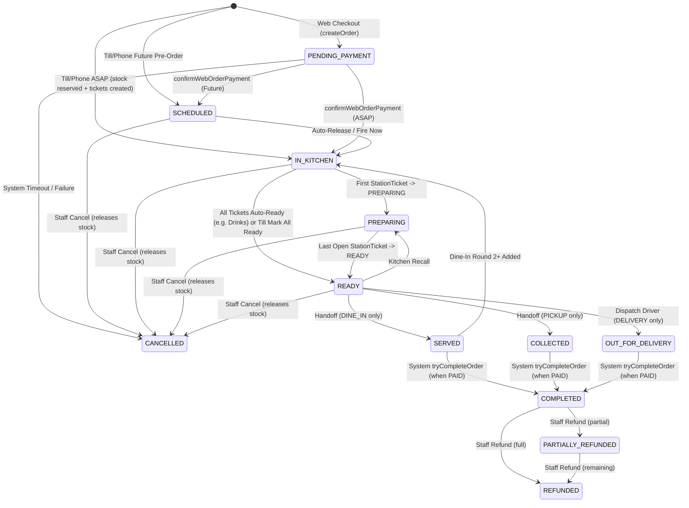
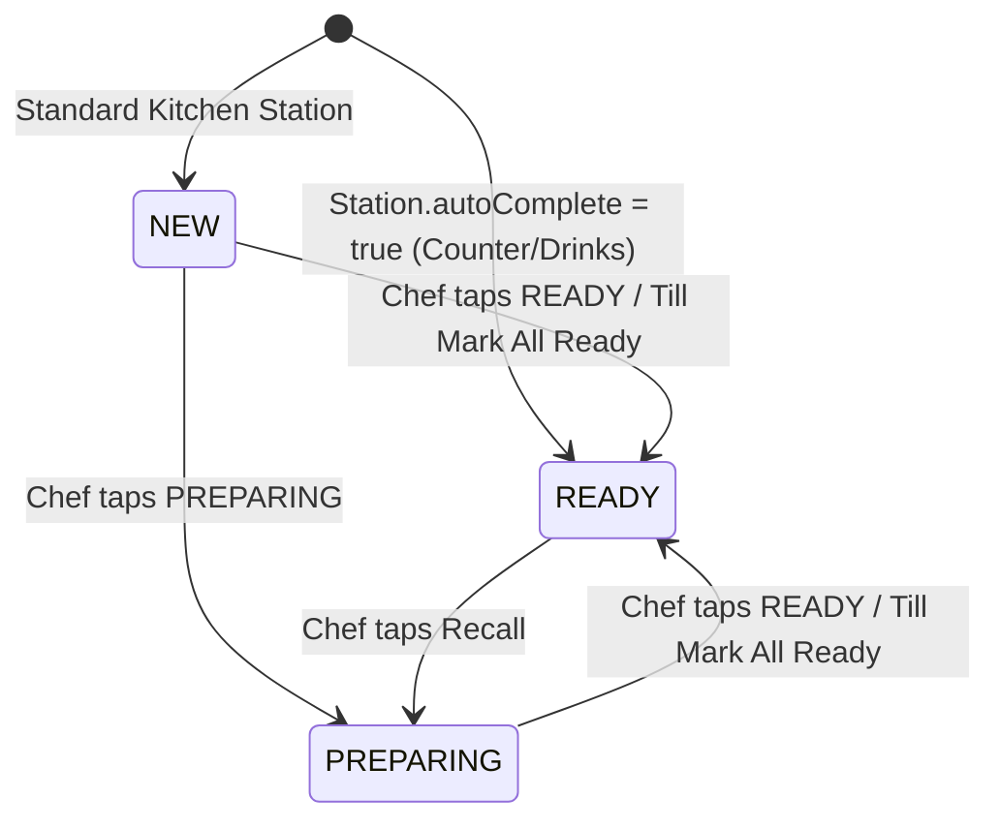
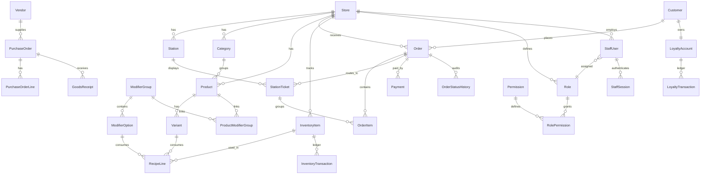

# Star Kebab — System Architecture

**Stack:** Next.js 15 (App Router, React 19, TypeScript strict) · Tailwind CSS v4 · Prisma 6 · TiDB Cloud Starter (MySQL-compatible, TLS) · Stripe · SSE + Ably hybrid realtime · Vitest & Playwright.

---

## 1. App Router Route Groups

Routes are partitioned into clean Next.js 15 route groups so each surface has its own layout, chrome, and authentication boundary without leaking bundles:

| Route Group | URL Paths | Surface & Layout | Auth Boundary |
| --- | --- | --- | --- |
| `(site)` | `/`, `/menu`, `/deals`, `/about`, `/contact`, `/legal/*` | Public storefront with `StoreHeader`, announcement bar, `CartProvider`, `StoreFooter` | Public (optional customer session for header greeting) |
| `(checkout)` | `/checkout`, `/order/[publicId]` | Distraction-free checkout & live order tracker | Public; tracker gated by HMAC `trackingToken` (`?t=...`) or owning customer/staff |
| `(account)` | `/login`, `/account` | Customer sign-in, addresses, favourites, Star Rewards, order history | `CUSTOMER_COOKIE` (`sk_cust_session`) |
| `(staff)` | `/staff-login`, `/till`, `/station/[code]` | Staff login (Email or 4-digit PIN), Till POS + 6-tab board, Dark-mode KDS | `STAFF_COOKIE` (`sk_staff_session`) + RBAC permission checks |
| `(admin)` | `/admin`, `/admin/*` | Back-office sidebar layout driven by `ADMIN_MODULES` | `STAFF_COOKIE` + per-page `assertPermission` |
| `api/` | `/api/realtime/stream`, `/api/stripe/webhook` | SSE event stream & Stripe webhook receiver | Signed channel / Stripe webhook signature verification |

---

## 2. Single Mutation Pipeline (`defineAction`)

Every Server Action in `src/modules/*/actions.ts` wraps its business logic with `defineAction` (`src/lib/action.ts`). No route or component mutates Prisma directly.

```
Client Form / Button
   │
   ▼
defineAction({ name, permission, schema, rateLimit, tx, audit, handler })
   ├── 1. getActor()         → resolves StaffActor | CustomerActor | AnonymousActor (React cache())
   ├── 2. assertPermission() → enforces 'public' | 'customer' | 'staff' | Permission key
   ├── 3. checkRateLimit()   → per-actor / per-IP sliding window guard (if configured)
   ├── 4. schema.parse(raw)  → strict Zod validation (ValidationError -> 400)
   ├── 5. db.$transaction()  → optional atomic transaction wrapper (when tx: true)
   ├── 6. writeAudit()       → immutable AuditLog row for staff mutations
   └── 7. ActionResult<R>    → { ok: true, data } | { ok: false, error: { code, message } }
```

All typed domain errors (`ValidationError`, `UnauthorizedError`, `ForbiddenError`, `NotFoundError`, `ConflictError`) in `src/lib/errors.ts` are mapped by `toActionError()` so UI components never receive raw stack traces or Prisma internals.

---

## 3. Data-Driven RBAC Registry (`modules.ts` & `permissions.ts`)

- **`src/config/permissions.ts`** defines the canonical `PERMISSIONS` array (34 granular keys such as `orders.serve`, `till.mark_all_ready`, `kitchen.prepare`, `inventory.adjust`, `finance.view`, `roles.manage`).
- **`src/config/modules.ts`** defines `ADMIN_MODULES`, mapping each admin sidebar link (`href`, `label`, `icon`, `group`) to its required `permission`. The admin sidebar filters `ADMIN_MODULES` against `actor.permissions`, and each page enforces the same permission server-side.
- **Effective Permissions Resolution (`getStaffActor`):**
  1. If `role.isSystem === true` (locked **Super Admin**), all `ALL_PERMISSION_KEYS` are granted automatically.
  2. Otherwise, the union of `RolePermission` rows for `staffUser.roleId` plus any individual `UserPermissionGrant` overrides is loaded into a `Set<Permission>`.
  3. Changing a staff member's role, disabling them, or resetting their password/PIN increments `StaffUser.sessionVersion`, immediately invalidating all existing `StaffSession` rows on the next request.

---

## 4. TiDB Cloud Starter Schema & RU Optimization

Star Kebab runs on **TiDB Cloud Starter** (MySQL 8 wire-compatible distributed SQL) with Prisma 6 (`provider = "mysql"`). To stay comfortably within Starter Request Unit (RU) and connection budgets:

1. **Composite Covering Indexes:** Every hot query path is backed by a targeted composite index in `prisma/schema.prisma`:
   - `Order`: `@@index([storeId, status, createdAt])`, `@@index([storeId, paymentStatus])`, `@@index([storeId, releaseAt])`, `@@index([storeId, scheduledFor])`.
   - `StationTicket`: `@@index([stationId, status, releaseAt])`, `@@index([orderId, status])`, `@@unique([orderId, stationId, round])`.
   - `InventoryTransaction`: `@@unique([sourceType, sourceId, inventoryItemId, kind])`, `@@index([inventoryItemId, createdAt])`.
   - `Product`: `@@index([storeId, categoryId, active])`.
2. **Batched Writes & Single-Query Includes:** Seeding and bulk role permission updates use `createMany({ skipDuplicates: true })` to minimize remote RTTs.
3. **No High-Frequency DB Polling:** Realtime updates use ID-only SSE/Ably push events (`order.created`, `order.updated`, `order.ready`, `order.paid`) triggering targeted `router.refresh()`, with a conservative 30 s safety interval on Till/KDS (10 s on active guest tracker, stopped once terminal).
4. **Singleton Prisma Client & TLS:** `src/lib/db.ts` caches `PrismaClient` on `globalThis` in development and connects via TLS using the pinned Let's Encrypt root CA (`prisma/isrgrootx1.pem`).
5. **Atomic Conditional Updates (`updateMany`):** State transitions, payment balance guards, and `tryCompleteOrder` use conditional `WHERE` clauses (`where: { id, status: requiredStatus, paymentStatus: 'PAID' }`) rather than pessimistic `SELECT FOR UPDATE` locks, avoiding distributed lock contention in TiDB.

---

## 5. Order & StationTicket Lifecycle (State Machine)

`COMPLETED` is strictly `'system'`-controlled (`tryCompleteOrder`). No staff role or UI button can mark an order `COMPLETED` directly; the system transitions it automatically the instant both fulfilment handoff (`SERVED` / `COLLECTED` / `OUT_FOR_DELIVERY`) and `paymentStatus === 'PAID'` hold.



### StationTicket Sub-Lifecycle



---

## 6. Entity-Relationship Summary (ERD)


