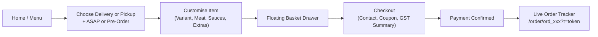
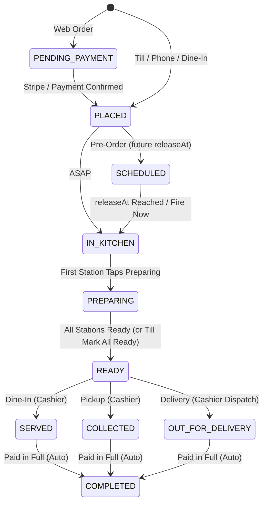

# Star Kebab — Complete Platform User & Operations Guide

> Everything you need to run **Star Kebab** day-to-day: the Public Ordering Website, Customer Accounts, Till / POS Hub, Kitchen Station Screens (KDS), and the Admin Portal.

---

## 1. Platform Overview & Portal Map

Star Kebab is a single unified Next.js + TiDB Cloud platform split into **4 clear experiences**:

| Portal | URL | Who Uses It | Purpose |
|---|---|---|---|
| **Public Storefront** | `/` · `/menu` · `/deals` · `/checkout` | Customers | Browse menu, customise kebabs/HSP/pide, apply coupons, pay online (ASAP or Pre-Order), and track orders live. |
| **Customer Account** | `/login` · `/account` | Registered Customers | View past orders, Star Rewards points balance & history, and saved delivery addresses. |
| **Staff Login & PIN** | `/staff-login` | All Staff | Sign in with Email + Password or quick-switch with a 4-digit Staff PIN. |
| **Till / POS Hub** | `/till` | Counter Staff, Cashiers, Managers | Take walk-in, phone, and dine-in orders; manage the 6-tab Live Operations Board; take Cash/EFTPOS/Split payments; print 80mm AU Tax Invoices. |
| **Kitchen Station Screens (KDS)** | `/station/all` · `/station/kebab` · `/station/snack-pack` · `/station/pizza` · `/station/grill` · `/station/fryer` | Chefs & Kitchen Crew | High-contrast dark-mode screens showing only tickets for each station. Tap **PREPARING** and **READY**. |
| **Admin Portal** | `/admin` (+ 13 sub-tabs) | Owner & Managers | Live KPIs, Catalogue & 86 toggles, Inventory & Recipes, Vendors & POs, Deals/Coupons, Finance & Z-Report, CMS, Staff, Dynamic Roles, Audit Log, Settings. |

---

## 2. Demo & Seed Accounts

Out of the box (`pnpm db:seed`), four accounts are ready to test every role and permission boundary:

| Role | Email | Password | 4-Digit PIN | Access Scope |
|---|---|---|---|---|
| **Owner (Super Admin)** | `admin@starkebab.com.au` | `StarAdmin123!` | `1111` | Full access to Admin, Till, KDS, Finance, Roles, Settings. |
| **Counter Staff** | `till@starkebab.com.au` | `StarStaff123!` | `2222` | Till POS, Serve/Collect/Dispatch, Payments, Mark All Ready, up to 10% discount. **Blocked (403)** from `/admin/finance`, `/admin/roles`, `/admin/settings`. |
| **Kitchen Chef** | `chef@starkebab.com.au` | `StarStaff123!` | `3333` | Kitchen Station KDS screens only (`kitchen.view`, `kitchen.prepare`, `kitchen.recall`). |
| **Demo Customer** | `alex@example.com.au` | `Customer123!` | — | Customer storefront & `/account` (starts with 250 Star Rewards points). |

> [!TIP]
> On `/staff-login`, you can click any of the **Seed Demo Accounts (Quick Fill)** cards to populate the email & password automatically, or switch to the **Staff PIN Pad** tab and enter `1111`, `2222`, or `3333`.

---

## 3. Customer Flow (Public Website)



### Step-by-Step Customer Experience
1. **Landing on Home (`/`)**:
   - Customers see the warm **Charcoal Grill & Saffron** hero banner, active announcement bar (e.g., late-night hours & promo codes), and **Active Combos & Deals** directly below the hero.
   - Clicking the **Fulfilment Chip** in the header (`Pickup · ASAP · Change`) lets them switch between **Pickup** and **Delivery** (entering an Australian postcode such as `2042` or `2000` checks delivery zone eligibility, delivery fee, minimum order, and ETA).
2. **Browsing the Menu (`/menu`)**:
   - Sticky category tabs (*Charcoal Kebabs, Halal Snack Packs, Wood-Fired Pizza & Pide, Charcoal Grill Plates, Sides & Entrées, Cold Drinks*), instant search bar, and filter chips (*All, Halal, Veg, Spicy, Best Sellers*).
   - Items marked **86 / Sold Out** by staff are immediately flagged on the menu and cannot be added.
3. **Customising an Item**:
   - Clicking any food card opens the **Product Customiser Modal**.
   - Customers pick a **Variant** (e.g. *Regular* vs *Large Jumbo*), required **Choice of Meat** (pick 1), **Fresh Salads**, **Sauces** (up to 3), **Add Extras** (+Cheese, +Extra Meat, +Halloumi), special notes, and quantity.
   - The button updates live in AUD (`Add to Order · $14.50`).
4. **Basket & Checkout (`/checkout`)**:
   - The floating bottom-right **Basket Button** opens the slide-over drawer.
   - At `/checkout`, customers confirm **Pickup vs Delivery**, **ASAP vs Schedule Pre-Order**, enter contact details (Name, Mobile, Email for tax invoice & tracking link), and optionally apply a promo code:
     - `STAR15` — **15% off** orders over \$20.00
     - `WELCOME5` — **\$5.00 off** orders over \$25.00
   - Totals are **recomputed strictly on the server** in integer cents with Australian **GST (1/11th inclusive)** shown clearly.
   - Clicking **Pay & Place Order** confirms payment (in Test Mode, instant confirmation; in Live Mode, via verified Stripe webhook), reserves ingredient stock, splits the order across kitchen stations, and redirects to the **Live Order Tracker**.
5. **Live Order Tracker (`/order/[publicId]?t=[token]`)**:
   - Works without logging in (secured by an HMAC-signed token in the URL).
   - Displays a 4-stage live progress bar: **Order Received → Preparing on the Grill → Ready / Out for Delivery → Completed**, auto-updating via Server-Sent Events (SSE), alongside the itemised GST Tax Invoice summary and store phone link.
6. **Customer Account (`/account`)**:
   - Signed-in customers see their **Star Rewards** points balance (1 point per \$1 spent on completed orders; 100 points = \$5 value), point history, saved addresses, and past orders.

---

## 4. Order Lifecycle & Three Fulfilment Flows

Every order — whether from the **Website**, **Walk-In**, **Phone**, or **Dine-In** — lands on the **same Till Operations Board** and is **automatically split by kitchen station**.



> [!IMPORTANT]
> **Hard Business Rule — Automatic Completion Only:**
> There is **no manual "Complete" button** anywhere in the system. An order moves to `COMPLETED` **automatically** the exact moment BOTH conditions are true:
> 1. The fulfilment handoff is done (`SERVED`, `COLLECTED`, or `OUT_FOR_DELIVERY`), **AND**
> 2. `paymentStatus === PAID` (balance due = \$0.00).

### How Each Fulfilment Type Works

| Stage | DINE-IN (Pay After Eating) | PICKUP | DELIVERY |
|---|---|---|---|
| **1. Placed** | Staff enters order on `/till` with **Table #** (unpaid). Goes straight to kitchen. | **Web:** hidden until paid online, then enters kitchen. **Phone/Walk-in:** entered on `/till` (pay now or on pickup). | **Web:** hidden until paid online. **Phone:** entered on `/till` (prepaid or Cash on Delivery). |
| **2. Kitchen** | Auto-split to Kebab / Pizza / HSP / Grill / Fryer screens. Drinks auto-Ready. | Same (or waits in **Scheduled** if pre-order). | Same. |
| **3. Ready Tab** | Cashier clicks **Mark Served (Table X)** → moves to **Served – Awaiting Payment**. | Cashier clicks **Mark Collected**. If already paid online → **auto-completes immediately**. If unpaid → take payment first. | Cashier clicks **Dispatch** (+ optional driver name). If already paid online → **auto-completes**. If COD → stays in **Out for Delivery** until cash is recorded. |
| **4. Payment** | Cashier clicks **Take Payment** (Cash + change / Card EFTPOS / Split). Balance hits \$0 → **auto-completes**. | Paid online or at collection. | Paid online or recorded when driver returns. |
| **5. Add-Ons** | Need more food for Table 5? Click **Add Round 2** on the served card — only the new items go to the kitchen while the bill combines both rounds! | — | — |
| **6. History** | Leaves all live tabs and appears **only** in **Order History** with full payment & timeline details. | Same. | Same. |

---

## 5. Till / POS Hub Guide (`/till`)

### Top Control Bar
- **Live Indicator (`LIVE`)**: Shows SSE realtime connection status.
- **Solo Mode Toggle (`Solo Mode: OFF / ON`)**: When running the shop solo (1 person), turn Solo Mode **ON** to show inline **Preparing / Ready** buttons directly on the Till without needing separate kitchen tablets.
- **Pause Online**: Temporarily pauses ASAP website ordering during a heavy rush with a custom message (pre-orders remain open).
- **Open / Close Drawer**: Manages the shift's **Cash Session** (opening float, live cash sales tracking, closing counted cash, and variance report).
- **Quick Links**: Jump straight to **Kitchen KDS (`/station/all`)**, **Admin (`/admin`)**, or **Sign Out**.

### Mode 1: New Order POS
1. Pick fulfilment: **Dine-in** (enter Table #), **Pickup**, or **Delivery** (enter address & postcode).
2. Toggle **Phone Order** if taking an order over the phone, and choose **ASAP** or **Schedule** (date & time).
3. Tap category tabs or search items. Tap any product to select variants & modifiers.
4. *(Optional)* Toggle the **86** badge on a product if an item runs out mid-shift — it disappears from the website immediately.
5. *(Optional)* Apply a manual discount % (automatically capped at your role's `maxDiscountPct`).
6. Tap **Place Order** — sends a unique idempotency key so double-taps never create duplicate orders.

### Mode 2: Live Operations Board (6 Tabs)
1. **Kitchen** — Shows all active orders (`IN_KITCHEN` / `PREPARING`) with per-station progress pills (e.g., `Kebab` flame icon, `Pizza` check icon).
   - **Mark All Ready**: Opens a station-grouped checklist so the cashier can double-check every item and bump all remaining tickets Ready in one tap (audited as `bumpedFromTill`).
2. **Ready** — Orders where every station is finished. Action buttons match the fulfilment type (**Mark Served**, **Mark Collected**, **Dispatch**).
3. **Served – Awaiting Payment** — Open dine-in tables. Includes **Take Payment** and **Add Round 2** buttons.
4. **Out for Delivery** — Dispatched deliveries awaiting Cash-on-Delivery confirmation (**Record COD Payment**).
5. **Scheduled** — Future pre-orders waiting for their `releaseAt` time. Staff can click **Fire to Kitchen Now** to send one early.
6. **Order History** — Completed, cancelled, and refunded orders only. Expand any row to see:
   - Full item/modifier breakdown & GST
   - Every payment row (method, tendered, change, EFTPOS reference, Stripe ID, cashier name)
   - Complete chronological status timeline
   - **80mm Invoice** button to print a compliant Australian GST Tax Invoice.

### Taking Payment (Cash, EFTPOS, Split)
- Click **Take Payment** on any unpaid/partially paid order.
- Choose **CASH** (quick-tap `$10`, `$20`, `$50`, `$100`, or `Exact`; live change is calculated automatically) or **CARD EFTPOS** (enter terminal reference).
- **Split Payments**: Enter a partial amount (e.g. `$10.00` Card), record it, then record the remaining balance in Cash. The order auto-completes the moment the balance reaches `$0.00`.

---

## 6. Kitchen Station Screens Guide (`/station/[code]`)

Designed specifically for hot, greasy, late-night kitchens:
- **Dark-mode high-contrast UI** (`#120E0D` charcoal background, large typography, zero glare).
- **Station Switcher Tabs**: Switch between `All Stations` (`/station/all`), `Kebab Station` (`/station/kebab`), `Snack Pack (HSP)` (`/station/snack-pack`), `Pizza & Pide Oven` (`/station/pizza`), `Charcoal Grill` (`/station/grill`), and `Fryer & Entrées` (`/station/fryer`).
  - *Note:* `Counter & Drinks` has `autoComplete = true`, so cold cans never clutter kitchen screens.
- **All-Day Summary Bar**: Top bar totals up identical items across all open tickets (e.g., `ALL-DAY: 5× Signature Charcoal Kebab · 3× Large Holy Trinity HSP`) so chefs can batch-cook efficiently.
- **Urgency Age Timers**: Ticket headers change colour automatically as tickets age (**Green** normal → **Amber** > 8 mins → **Red** > 15 mins).
- **Allergy & Special Notes**: Highlighted in high-contrast red with a warning icon so they are impossible to miss.
- **Giant Touch Buttons (≥ 56px)**:
  - Tap **PREPARING** when starting the ticket (notifies the Till and updates the customer's Live Order Tracker).
  - Tap **READY** when plated/wrapped — the ticket disappears from the Kitchen tab immediately. Once the *last* station for an order taps Ready, the whole order moves to the Till's **Ready** tab.
- **Recently Ready Recall Bar**: Accidentally tapped Ready? Tap the order pill in the bottom recall bar to pull it back to `PREPARING` (audited).

---

## 7. Admin Portal Guide (`/admin`)

The Admin sidebar is **dynamically generated** from `src/config/modules.ts` and filtered by the signed-in user's permissions. Every page and server action also enforces permissions on the server.

| Admin Tab | Route | What You Can Do |
|---|---|---|
| **Dashboard** | `/admin` | Real-time DB aggregates: Today's & Total Paid Revenue, AOV, Orders by Status/Channel/Fulfilment, Recharts Revenue & Channel charts, Low-Stock alerts, Upcoming Pre-orders, Pending POs, and System Telemetry. |
| **Live Orders** | `/admin/orders` | Filterable, paginated view of all orders across statuses with quick jump to `/till`. |
| **Kitchen Stations** | `/admin/stations` | Add new stations (e.g. *Dessert*), toggle `autoComplete`, view open ticket load, and launch any `/station/[code]` screen directly. |
| **Catalogue & Menu** | `/admin/catalog` | Create categories, products, and variants; toggle **Active/Disabled** (soft-disable only — historical orders never break) and **86 Sold Out**. Changes revalidate the storefront immediately without redeployment. |
| **Inventory & Recipes** | `/admin/inventory` | View ingredient on-hand levels (`Decimal(12,3)`), low-stock highlights, post **Adjustment**, **Waste**, or **Stocktake Count** entries, and inspect the immutable append-only `InventoryTransaction` ledger. |
| **Vendors & POs** | `/admin/purchasing` | Manage suppliers (ABN, contact, address), create Purchase Orders, and record **partial or full Goods Receipts** (stock increases strictly on receipt). |
| **Deals & Coupons** | `/admin/deals` | Create/toggle homepage combo deals and promo codes (`PERCENT` or `FIXED`, min spend, active status). |
| **Customers & Loyalty** | `/admin/customers` | Search customer directory, view order counts and Star Rewards point balances. |
| **Finance & Cash** | `/admin/finance` | Revenue breakdown by payment method (Cash / EFTPOS / Online), record business expenses (creates `OUTFLOW` financial ledger rows), review Cash Session Z-Reports & variances, and export CSV. |
| **Website & CMS** | `/admin/cms` | Edit the live storefront announcement bar, view header/footer navigation links, and inspect branding tokens. |
| **Staff & PINs** | `/admin/staff` | Create staff accounts, assign roles, set 4–6 digit Till PINs, or disable staff (immediately revokes active sessions via `sessionVersion`). |
| **Roles & Permissions** | `/admin/roles` | Create custom roles (e.g. *Shift Supervisor*, *Delivery Driver*) and tick permissions in the **Module × Permission Matrix**. Super Admin is locked; saving a role bumps `sessionVersion` so changes apply on the very next request. |
| **Audit Log** | `/admin/audit` | Searchable, append-only trail of every staff mutation (who, action, timestamp, request ID). |
| **Store & Branding** | `/admin/settings` | Edit store name, ABN, phone, address, GST rate, card/public-holiday surcharge bps, Solo Mode, Online Pause, opening hours, time-slot capacities, and delivery postcode zones. |

---

## 8. Daily Shop Playbook (Opening → Service → Closing)

1. **Opening Shift (10:45 AM)**
   - Sign in at `/staff-login`, open `/till`, and click **Open Drawer** with your starting cash float (e.g. \$200.00).
   - Open kitchen tablets to their assigned stations (`/station/kebab`, `/station/snack-pack`, `/station/pizza`, `/station/grill`) — or turn on **Solo Mode** if one person is covering a quiet morning.
   - Check `/admin/inventory` for any **Low Stock** alerts and receive any morning supplier deliveries in `/admin/purchasing`.
2. **During Service Rush**
   - Web orders arrive paid on the **Kitchen** tab and split automatically to station tablets.
   - Walk-in, phone, and dine-in orders are keyed in on **New Order POS**; pre-orders sit quietly in **Scheduled** and surface automatically on kitchen screens at `releaseAt`.
   - If an ingredient runs out, tap **86** on the product tile to hide it from the website instantly.
   - If the kitchen gets slammed, click **Pause Online** on the Till bar to pause ASAP web orders while still accepting scheduled pre-orders.
3. **End of Night / Closing**
   - Ensure all open dine-in tables in **Served – Awaiting Payment** and any COD deliveries in **Out for Delivery** are settled so they auto-complete into **Order History**.
   - Click **Close Drawer** on `/till`, enter the counted cash, and review the variance.
   - Open `/admin/finance` to review the daily breakdown by payment method and export CSV for your accountant.

---

## 9. Developer & Deployment Commands

Run from `d:\kababshop\aus_kebab`:

```bash
pnpm dev          # Start local dev server (Turbopack)
pnpm typecheck    # Strict TypeScript check (tsc --noEmit)
pnpm build        # Prisma generate + Next.js production build
pnpm start        # Start production server on http://localhost:3000
pnpm db:push      # Push Prisma schema changes to TiDB Cloud
pnpm db:seed      # Seed Star Kebab store, stations, menu, roles, demo users
pnpm test         # Run all 24 Vitest unit + TiDB Cloud integration tests
pnpm test:e2e     # Run Playwright Chromium end-to-end browser tests
```
